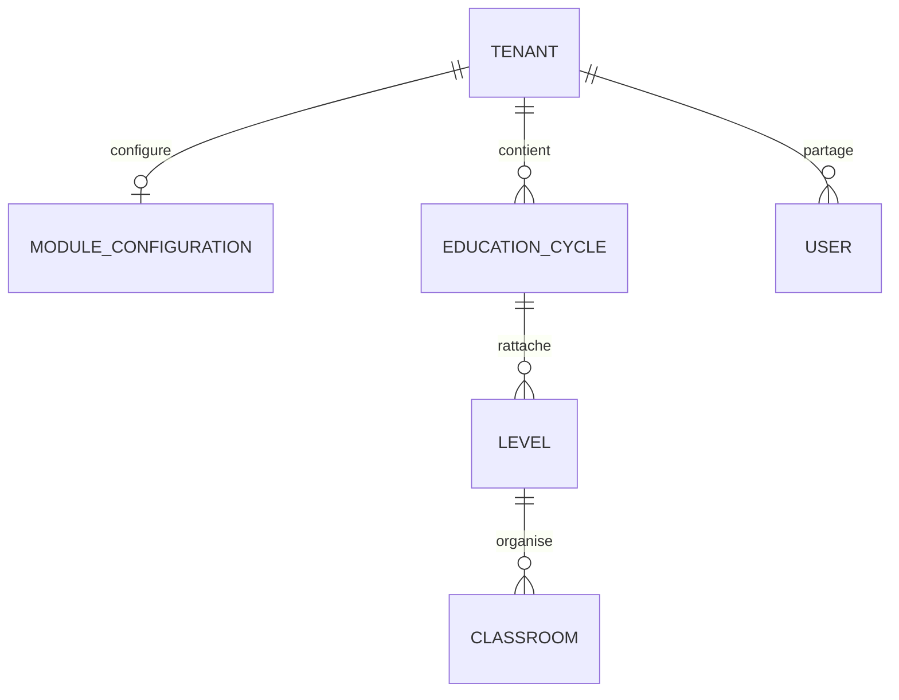

# Architecture cible — modules et cycles d'un établissement

## Principes

Le tenant reste l'établissement contractuel et administratif. Les cycles sont
ses périmètres pédagogiques : aucune duplication de compte, élève, parent,
facturation ou historique pour constituer un établissement mixte.

Décision d'accès : abonnement autorisant l'opération **et** permission RBAC
**et** module actif **et** périmètre réel de la ressource/cycle/utilisateur.
Une activation ne confère jamais un droit absent ; un menu masqué n'autorise rien.

## Sources d'autorité

- Catalogue versionné de modules et profils : identifiants stables, dépendances,
  routes/écrans couverts et disponibilité réelle des capacités.
- Configuration dédiée par tenant, avec révision, mise à jour atomique et audit ;
  indépendante des JSON génériques de présentation de `tenants.settings`.
- Cycles rattachés au tenant ; association progressive des niveaux existants.
  Les comptes et les données administratives restent dans leurs tables actuelles.
- Les règles existantes de `academic_rules.py` restent la source de calcul pour
  les notes sur 20 ; les adaptations de cycle sont ajoutées avec tests de bulletins.
- Les offres conservent `all_features: true` : le catalogue modulaire n'introduit
  pas un changement tarifaire implicite. Les quotas/échéances existants s'appliquent.

## Déploiement progressif sans perte

1. Inventaire et catalogue : conserver les cinq types existants et introduire
   explicitement maternelle, supérieur, professionnel et mixte. Ne pas recréer
   notes, ECTS, inscriptions ou paiements.
2. Moteur tenant et interfaces : aperçu sans écriture, activation/désactivation
   atomique, contrôle des dépendances, conflits de révision 409, audit, refus API
   direct et état de disponibilité visible. Le socle commun reste indispensable.
3. Cycles : migrations additives, association validée des niveaux, rôles et
   ressources ; pas de migration automatique des historiques ambigus. Toute
   route non encore capable de filtrer un cycle doit être explicitement marquée
   non couverte avant d'autoriser des politiques différentes entre cycles.
4. Pédagogie : étendre les règles existantes avec tests du résultat des bulletins,
   de la capitalisation et des transitions de configuration. Compétences, ECUE,
   compensation et diplômes ne sont activables que lorsque leurs parcours réels
   existent et sont vérifiés.

## Compatibilité et sécurité

Les établissements existants ne perdent pas automatiquement des fonctions à la
mise à jour. Une première activation présente le profil proposé, les modules qui
changent et les limites de couverture ; elle est explicite et auditée. Les nouveaux
établissements peuvent recevoir un profil initial une fois ce parcours testé.

Les modifications de configuration ne suppriment jamais de données métier. Les
routes canoniques, alias, lectures, écritures, exports, portails et tâches doivent
partager la même décision. Aucun cache navigateur ou paramètre d'URL ne constitue
une autorisation serveur. Toute politique par cycle doit utiliser le rattachement
réel des ressources, et refuser les identifiants d'un autre établissement.

Les tests doivent exercer PostgreSQL avec un rôle sans BYPASSRLS, les deux sens
des accès concurrents, l'isolation tenant/cycle, les permissions négatives et les
changements de configuration. Les parcours offline doivent conserver les brouillons
refusés après désactivation et afficher leur état ; pas d'effacement silencieux.
